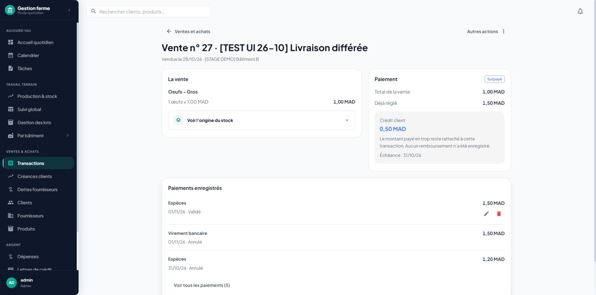

# Phase 6A staging acceptance — 1 November 2026

Application commit: `e56307aba6a87a0eb7c6fc0d588e4956c0cf3228`.
Verified deployment: `dpl_6C3Gu7MNFdXHzHJyZ3kxqZHM5Pit`.
The stable staging alias was assigned to this READY deployment. No production
deployment or schema change was made.

## Scope and automated checks

This increment explains surplus retained on a transaction and makes Python/SQL
payment status agree at cent precision. It does not implement refunds, advances,
credit transfers, cleared instrument corrections, or restoration/conversion.

- 124 backend tests passed across retained surplus, financial position, correction
  contracts, contact balances, enterprise remediation, history and atomicity.
- 21 frontend tests passed across balance presentation, desktop/mobile registers,
  transaction completion and refresh.
- Targeted ESLint: zero errors, two existing warnings. Frontend build passed.
- `/api/v1/health/live`: 200, service `api`, status `ok`.
- `/api/v1/health/ready`: 200, database `reachable`, status `ok`.

## Authenticated owner walkthrough

Used existing staging test sale 27, quantity 1, price/total 1.50 MAD, due
28 December 2026. Added cash payment 18 for 1.50 MAD with the marker
`[TEST PH6A 01-11] Retained credit acceptance`.

1. The original sale became paid with zero remaining balance.
2. Corrected unit price to 1.00 MAD and due date to 31 October 2026 together.
   Preview explained customer credit of 0.50 MAD and no recorded refund.
3. After confirmation, details showed `Surpayé`, `Crédit client`, positive
   `0,50 MAD`, and the retained-credit explanation. No additional-payment button
   or overdue status appeared.
4. The register showed customer credit 0.5 MAD and `Surpayé`. The `Non payées`
   filter excluded sale 27.
5. Read-only SQL confirmed payment 18 retained its 1.50 MAD amount, 1 November
   date and valid status. Cash movement 33 retained its 1.50 MAD incoming amount,
   original date and active status. There was exactly one active cash movement
   for sale 27; the price correction did not create a refund or replacement.
6. Used correction history to prepare the original price and due date, reviewed
   the preview and confirmed the new correction. Then canceled test payment 18
   through the payment UI.

## Cleanup and limits

Read-only staging SQL confirmed sale 27 is active with quantity 1, unit price and
total 1.50 MAD, original due date 28 December 2026, effective paid amount zero,
and zero active cash movements. Payment 18 and movement 33 have canceled status.
The UI again shows unpaid 1.50 MAD. Audit records remain intact.

Supplier credit, mobile presentation, and one-cent boundaries have automated
coverage; this live walkthrough exercised a customer sale on desktop.

Phase 6A is verified. Phase 6 remains open for the settlement and instrument
increments listed in the implementation tracker.
