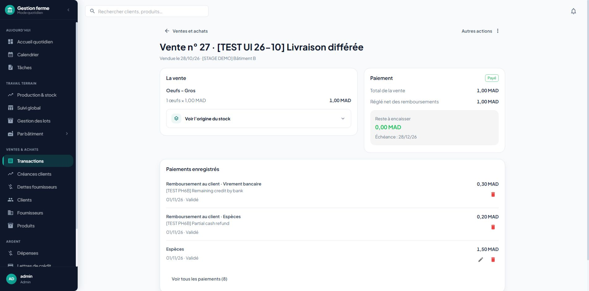
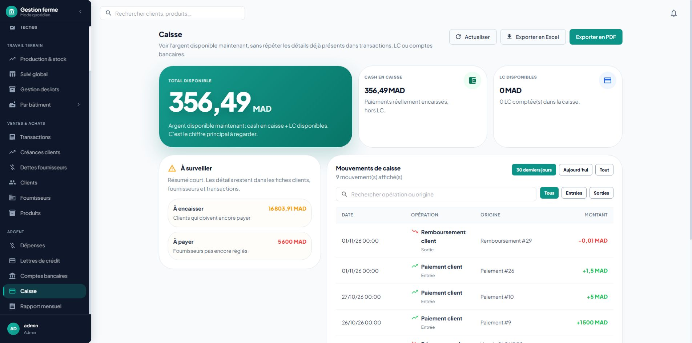

# Phase 6B — explicit refunds: staging evidence

Implementation commit `fb28a0c3ee93fda727e93c2e03cb9d39c6b9d614` adds refund preview,
atomic apply, retained-history settlement records and signed net projections.
Commit `8333b169245b87a56e50636d2bfd782e1db0192b` fixes fractional cash display
found in the owner walkthrough. The final follow-up also limits bank movement
notes to their 255-character capacity while preserving the full refund reason.

Migration `20261101232602_explicit_transaction_refunds` is applied to staging
project `aqosvbpcxfpntcejebma`. Existing payments default to ordinary payments;
their amounts and effects are unchanged. No production release was made.

## Verification

- 145 backend regressions passed; the subsequent 22-case focused refund suite
  includes the additional long-reason case (146 distinct cases across runs).
- 29 frontend tests across six files passed. The cash precision follow-up adds
  two passing desktop/mobile cases: 31 distinct frontend cases in seven files.
- Frontend build passed. Targeted ESLint: zero errors, four existing warnings.
- PostgreSQL rollback-only checks rejected excess refunds, reclassification,
  history deletion, refund-note rewrites and backdating that consumes credit
  already returned before a later payment. Test transaction rows rolled back.
- The security advisor raised no finding for the new refund guard. Its function
  uses SECURITY INVOKER and a fixed search path; public direct execution is revoked.
  Other pre-existing advisory groups concern unrelated lot functions, extensions
  and internal tables and were not modified by this increment.
- The public readiness endpoint returned `status: ok`, `database: reachable`
  through the existing browser session. No new share link was created for it.

## Authenticated owner walkthrough

Used staging test sale 27, originally 1 egg, 1.50 MAD and unpaid, due 28 December.

1. Recorded marked source payment 26 for 1.50 MAD in cash.
2. Corrected the price from 1.50 to 1.00 MAD, producing 0.50 MAD customer credit.
3. Previewed and confirmed refund 27 for 0.20 MAD in cash. Details showed net paid
   1.30 MAD, remaining credit 0.30 MAD, and an explicit refund entry. SQL confirmed
   a positive 0.20 MAD outgoing movement and an unchanged 1.50 MAD source payment.
4. Previewed and confirmed refund 28 for the final 0.30 MAD through test bank
   account `TEST-PH5-20261101`. Details became paid with zero credit and no refund
   action. The account had a single 0.30 MAD outgoing refund movement; its balance
   became -0.30 MAD, representing the synthetic test outflow.
5. Verified cash and bank history use refund labels. The first cash screen rounded
   the fractional refund to zero; fixed every cash monetary display to two-decimal
   precision and added desktop/mobile regressions before the follow-up deployment.
6. Canceled refunds 27 and 28 independently, retaining their records and restoring
   the credit and test-bank balance.
7. Prepared one-cent cash refunds in two tabs from the same starting balance.
   Confirmed refund 29 in the first tab. The second tab received a stale-preview
   rejection, disabled confirmation and created zero refund records for its marker.
8. On the follow-up deployment, verified cash history displays `-0,01 MAD`, the
   original payment displays `+1,5 MAD`, and the cash total preserves its cents.

## Cleanup and limits

Canceled test refund 29 through the UI, restored sale 27's original price through
correction history, and canceled source payment 26. Read-only PostgreSQL confirmed:

- Active sale 27: quantity 1, unit price/total 1.50 MAD, original due date unchanged.
- Effective paid amount zero; zero active linked cash or bank movements.
- Test account balance 0.00 MAD. Refunds and original payment remain in history.
- The rejected stale refund created zero records.

The manual walkthrough exercises customer cash/bank refunds. Automated tests cover
supplier reimbursements, both destinations, partial/full amounts, historical dates,
validation, retry equality, rollback of ledger/account writes and immutable values.
The two-tab test verifies stale-preview protection; it does not replace the later
full PostgreSQL concurrency, recovery and release gate.

Phase 6B is implemented and verified for ordinary cash/bank settlements. Cheque/LC
backed transactions remain gated. Advances and credit allocation, instrument chains,
and restoration/conversion remain open Phase 6 work. This evidence does not close
the full Phase 6 or authorize a production release.
